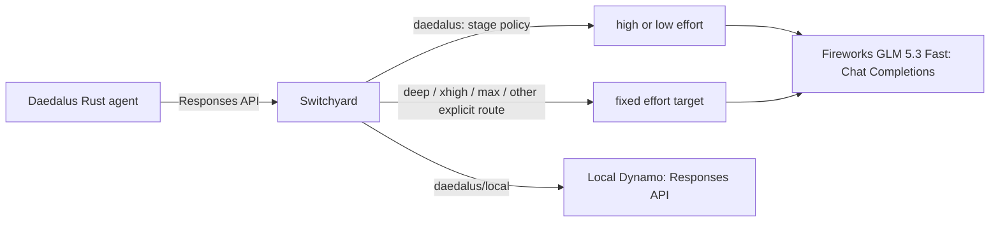

# Switchyard on Daedalus

This repository builds NVIDIA-NeMo Switchyard v0.2.0 with a local target-model
alias patch and deploys it as a non-root Helm workload in the `daedalus`
namespace. The default Fireworks route exposes model `daedalus` on the OpenAI
Chat Completions, OpenAI Responses, and Anthropic Messages endpoints.

`routes_fireworks.toml` uses the stage router with `capable_first` and exposes
explicit effort routes for GLM 5.3 Fast. All Fireworks targets use the same
provider model, `accounts/fireworks/routers/glm-5p3-fast`. Fireworks describes
[Fast](https://docs.fireworks.ai/serverless/serverless-modes) as a faster serving
mode of the same model. Switchyard chooses an effort target; Fireworks chooses
the inference replica. The `/local` route is a separate, explicitly requested
Dynamo model.

## Daedalus request path



Switchyard translates Responses input, tool calls/results, reasoning history,
and streamed output to and from Chat Completions. The downstream agent keeps
using `/v1/responses`; it does not need a Fireworks-specific provider adapter.
During the October 4, 2026 incident, direct GLM Responses streams stalled while
Chat Completions completed, so this upstream transport is intentional.

| Requested model | Switchyard target | Requested Fireworks effort | Use |
| --- | --- | --- | --- |
| `daedalus` | Stage policy: normally `high`, sometimes `low` | `high` / `low` | Automatic/default profile |
| `daedalus/deep`, `daedalus/xhigh` | `xhigh` | `xhigh` | Deep profile; daily summaries and mapped skills |
| `daedalus/max` | `max` | `max` | Explicit `deep_max` profile |
| `daedalus/high` | `high` | `high` | Fixed high effort |
| `daedalus/medium` | `medium` | `medium` | Fixed requested medium effort |
| `daedalus/low` | `low` | `low` | Explicit latency-oriented choice |
| `daedalus/none` | `low` | `low` | Compatibility alias; thinking remains enabled |
| `daedalus/local` | `local` | N/A | `nvidia/Muse-Glimmer-30B-NVFP4` on local Dynamo |

The effort column describes the value sent on the wire. Live GLM probes accepted
`low`, `medium`, `high`, `xhigh`, and `max` on October 6, 2026; that does not prove
five distinct internal compute tiers. The provider explicitly rejected `none`
because GLM 5.3 is thinking-only. `/none` therefore aliases `/low` and preserves
reasoning between tool calls within the current user turn. It does not send
`reasoning_effort="none"` or discard in-turn reasoning.

Daedalus selects profiles before Switchyard selects targets. Explicit request
profiles take precedence. With automatic selection, daily-summary requests
start deep; loading `daily-summary`, `fantasy-football-recap`, `sre-engineer`, or
`kubernetes-specialist` promotes subsequent rounds to deep. `deep_max` is
explicit only. The deployed deep override is `daedalus/xhigh`; the workflow's
fallback `daedalus/deep` resolves to the same target. These choices do not change
tools, approval authority, timeouts, or iteration budgets.

### What the stage router actually does

The pinned Switchyard stage router reads coding-tool signals, not prompt
complexity. It does not make an additional classifier-model call in this
configuration. `capable_first` selects `high` when signals are absent or
inconclusive. Critical errors or a recognized compaction marker force high.
Passing tests plus recent recognized writes/edits and no recent error select
low. Other decisions use a weighted error/production score, with threshold
`0.5` and a window of three recent tool results/calls; the threshold is not a
calibrated probability of task success.

Most Daedalus research/MCP tools do not match the coding write/edit patterns.
The October 6 audit found all 850 default-route requests in the preceding
24 hours selected high. Treat the default as quality-first, not as a semantic
cheap-versus-hard classifier. Explicit effort routes bypass stage decisions.
There is no configured provider failover, and Fireworks failures never silently
send the request to the local model. Daedalus owns its bounded model retries.

An isolated October 6 comparison kept the deployed binary/model and changed
only the picker to `efficient_first` and threshold to `0.3`. Twenty synthetic
tasks with two paired repetitions covered no-tool answers, single/independent/
dependent reads, tool-error recovery, and long context. The all-attempt
gateway-loop p50/p95 were 5.72s/25.71s for the current policy and 7.98s/36.36s
for low-first. Exact answer/format assertions passed 28/40 and 29/40,
respectively, but low-first failed six cases the baseline passed. Both arms
had format failures, and the small sample does not establish general model
quality. Low-first failed the frozen correctness and latency gates and was
not promoted. The deployed default remains `capable_first` at `0.5`.

### Conversation affinity and defaults

The Rust agent sends the standard OpenAI-compatible `user` field as a SHA-256
key scoped to the authenticated user and conversation. All model/tool rounds
and later turns in that conversation reuse it; requests without a conversation
use a run-scoped key. Raw user/conversation IDs are not sent in this field.
Switchyard preserves it through Responses-to-Chat translation.

Fireworks supports [`user` for prompt-cache affinity](https://docs.fireworks.ai/guides/prompt-caching).
Do not add one fixed `x-session-affinity`, `x-multi-turn-session-id`, or Dynamo
session ID to `llm_clients.extra_headers`. A fixed key groups unrelated traffic
onto one affinity destination. Clients that explicitly send per-session
headers are still supported; Fireworks prioritizes
[`x-multi-turn-session-id`](https://docs.fireworks.ai/guides/rollout-inference)
over `x-session-affinity`. Affinity improves the opportunity for prefix reuse;
cache hits still depend on exact prompt prefixes, replica placement, and load.

Target defaults are illustrated below:

```toml
[targets.high]
id = "high"
model = "accounts/fireworks/routers/glm-5p3-fast"
llm_client = "fireworks"
extra_body = { reasoning_effort = "high", reasoning_history = "interleaved" }

[targets.low]
id = "low"
model = "accounts/fireworks/routers/glm-5p3-fast"
llm_client = "fireworks"
extra_body = { reasoning_effort = "low", reasoning_history = "interleaved" }
```

`id` identifies the routing target. The optional `model` names the model sent to
the provider; omitting it preserves the original behavior where `id` serves
both purposes. Distinct routing IDs keep each target's defaults independent,
even when they share a client and provider model. Separate clients alone do
not solve this for the stock v0.2.0 stage router, which also selects targets by
ID. The Dockerfile applies `patches/target-model-aliases.patch` to the pinned
source. **Rebuild the image before deploying this Fireworks configuration**;
the unpatched image rejects the new `model` field.

Switchyard treats `extra_body` as a default-only, shallow top-level merge. An
explicit reasoning effort in the inbound request wins after translation to
`reasoning_effort`. The route advertises
`reasoning = false` so clients using discovery do not automatically supply an
effort that overrides the selected target.

The Fireworks targets use native Chat Completions fields. Do not add the
Responses-only `truncation` field to their `extra_body`: Fireworks rejects it
on Chat Completions. Switchyard translates the downstream Responses request
before applying these target defaults.

## Files

- `routes_fireworks.toml`, `routes_openai.toml`, and `routes_local.toml` are the
  selectable deployment sources for clients, targets, and routes.
- `charts/switchyard/` contains the Helm chart.
- `Dockerfile` builds the pinned upstream v0.2.0 commit with the target-model alias patch.
- `scripts/deploy.sh` reconciles the API-key Secret, forces a fresh pod rollout,
  deploys Helm, and checks rollout, EndpointSlice, and HTTP health.

The chart mounts the selected routes file as `routes.toml` from a ConfigMap and
starts Switchyard directly.
It also exposes `/health` for Kubernetes probes and `/metrics` for an optional
Prometheus `ServiceMonitor`.

## Validate

```bash
make validate
make validate ROUTES_FILE=routes_local.toml
```

This lints the chart, renders it into the `daedalus` namespace, and runs
Kubernetes client-side validation. Route policy is intentionally not validated,
so the selected routes file can be changed freely while experimenting.

The transport tests use a built binary and a local mock to check both stage
defaults, critical-error escalation, every Fireworks route, buffered/streaming
Responses, tool history, caller effort overrides, open argument schemas, and
conversation affinity. Configuration invariants and the route smoke harness
also run. The mocks do not contact Fireworks:

```bash
SWITCHYARD_TEST_BINARY=/path/to/switchyard-server \
  python3 -m unittest discover -s tests -v
```

## Test deployed routes

```bash
make test routes_fireworks.toml
# Equivalent, with the default routes file:
make test
make test ROUTES_FILE=routes_local.toml
```

This sends one live, non-streaming `/v1/responses` request for **every entry in
`[routes]`**, using its `id` as the requested model. For the Fireworks file,
that includes `stage`, `max`, `xhigh`, `deep`, `high`, `medium`, `low`, `none`, and `local`.
The TOML selects the
route IDs to test; the running server supplies their routing policy, upstream
settings, and credentials. Deploy the intended TOML first. This command does
not deploy or check that the server's configuration matches the local file.

By default it opens a temporary localhost port-forward to
`daedalus/service/switchyard:4000` using `EXPECTED_CONTEXT` and closes it on
completion or interruption. This requires Python 3.11+ and `kubectl` access to
the deployed Service and pods. You can instead supply a reachable Switchyard
URL (with or without `/v1`), which does not require `kubectl`:

```bash
make test routes_fireworks.toml TEST_BASE_URL=http://localhost:4000/v1
make test routes_fireworks.toml TEST_TIMEOUT=180 TEST_MAX_OUTPUT_TOKENS=8192
```

The prompt asks for `OK`, with a default budget of 4096 output tokens to allow
for reasoning and a 120-second HTTP timeout per route. These are real inference
requests and use the deployed providers. No reasoning effort is sent, so each
route keeps its configured default. A pass requires a completed response with
nonempty assistant text; HTTP errors, incomplete/failed responses, invalid JSON,
and empty output fail. Every route is attempted, with HTTP status, elapsed time,
selected-model header, and a short response or error printed. Any failed route
returns a nonzero exit status.

`TEST_NAMESPACE` and `TEST_SERVICE` override the port-forward destination.
The route tester's local HTTP-fixture tests run without provider credentials:

```bash
python3 -m unittest discover -s tests -p 'test_route_smoke.py' -v
```

## Build, publish, and deploy

No official v0.2.0 container is assumed. Build the pinned upstream commit and
push it to a registry every Kubernetes node can pull from. Each route target
runs the complete image build, push, and guarded deployment sequence:

```bash
make deploy-route_fireworks
make deploy-route_openai
make deploy-route_local
```

For an immutable deployment, record the pushed manifest digest and provide it
as `IMAGE_DIGEST=sha256:...` during deployment.

To deploy an already-published image without rebuilding it, select the routes
file explicitly:

```bash
make deploy ROUTES_FILE=routes_local.toml
```

The defaults are image repository
`daedalus.ddns.me:5050/btuttle/switchyard`, tag `v0.2.0`, and Kubernetes context
`kubernetes-admin@kubernetes`; each can still be overridden as a Make variable.

Copy `.env.example` to `.env` and set every credential named by an
`llm_clients.*.api_key_env` entry in the selected routes file. `.env` is ignored
by Git. The deployment script discovers the unique names from that file,
creates matching Kubernetes Secret keys, and injects those keys into the
Switchyard container. It does not place credential values in Helm values or the
ConfigMap.

The script fixes the namespace to `daedalus`, release name to `switchyard`, and
Secret name to `switchyard-api-key` by default. Override `RELEASE_NAME` or
`SECRET_NAME` only when you also intend to change those resource names.

Each invocation adds a new non-secret restart annotation to the pod template.
This makes Secret and mutable image-tag updates take effect in newly started
containers. For each name discovered from the selected routes file, a value
supplied by the caller environment takes precedence over the same name in
`.env`. The Fireworks clients use `FIREWORKS_API_KEY`; unrelated variables are
ignored.

The default scheduling contract requires `amd64` and excludes the ARM64
`daedalus-06` worker. Publish a compatible multi-architecture image and override
`nodeSelector` and `affinity` together if that topology changes.

## Call the route

The Service defaults to `NodePort` and pins the external port to `30260`. From
a network that can reach a cluster node, use this base URL:

```text
http://<node-ip>:30260/v1
```

Inside the cluster, use this base URL:

```text
http://switchyard.daedalus.svc.cluster.local:4000/v1
```

Set `service.type=ClusterIP` to disable node-level exposure; the chart omits the
configured `service.nodePort` unless the Service type supports node ports.

For example:

```bash
curl http://switchyard.daedalus.svc.cluster.local:4000/v1/responses \
  -H 'Content-Type: application/json' \
  -d '{"model":"daedalus","input":"Inspect and fix the failing tests."}'
```

Routed responses include `x-model-router-selected-model` and, when available,
`x-model-router-rationale`. With the Fireworks aliases, the selected-model
header identifies the target, such as `high`, `low`, or `xhigh`; the request sent
to Fireworks uses the full provider model ID from `model`.
