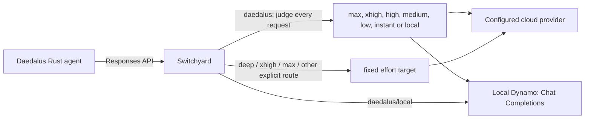

# Switchyard on Daedalus

This repository builds NVIDIA-NeMo Switchyard v0.3.0 with local target-model
alias, Fireworks reasoning, Composite fallback, native decision API and
structural credential redaction patches.

Credential redaction walks decoded JSON strings before serializing responses.
Replacing credentials in serialized JSON could match across an escape boundary
and produce an invalid stream event, aborting long Daedalus briefings. The
`structural-credential-redaction.patch` also walks JSON encoded inside tool
arguments and preserves their spelling when no credential changed. The build
runs redactor regressions; the HTTP fixture covers large reasoning events,
valid nested arguments, continued credential removal and unchanged upstream auth.

It deploys a non-root Helm workload in the `daedalus` namespace. The Fireworks configuration
exposes model `daedalus` on the OpenAI Chat Completions, OpenAI Responses, and
Anthropic Messages endpoints.

`routes_custom.toml` and `routes_openai.toml` expose `daedalus` with automatic
selection of `max`, `xhigh`, `high`, `medium`, `low`, `instant`, and `local`.
Sensitive work (including reading, summarizing, or replying to email) prefers
`local` before considering difficulty. Greetings and simple social exchanges
use `instant`; routine synthesis uses `medium`. The custom configuration uses
Fireworks, Inception and local Dynamo; the OpenAI configuration uses OpenAI and
the local Dynamo endpoint. Both retain explicit `daedalus/<profile>` routes.

This is a classifier preference, not a local-only privacy guarantee: the local
decision service receives classification context, and judge or provider
failure can still choose the cloud `default_target`. Clients requiring local-only
answering should request `daedalus/local`, which bypasses the classifier and
automatic fallback. Automatic policy changes take effect when the updated route
file is deployed; they do not alter the provider models or effort defaults.

`routes_inception.toml` uses Inception Labs' `mercury-3` through its
[OpenAI-compatible Chat Completions API](https://docs.inceptionlabs.ai/get-started)
at `https://api.inceptionlabs.ai/v1`, with `INCEPTION_API_KEY`. It defines all four
[supported reasoning efforts](https://docs.inceptionlabs.ai/capabilities/reasoning-efforts):
`instant`, `low`, `medium`, and `high`. Automatic Composite routing uses the same
local Clef decision service, selecting low for simple work, medium for bounded
multi-step work, and high for substantive code, briefings, complex tasks and
fallback. Low and medium require 0.90 choice probability; high is the fallback.
These are initial routing policies, not calibrated Mercury task-success rates.
`daedalus/high`, `/medium`, `/low`, and `/instant` select their named efforts;
`/max`, `/xhigh`, and `/deep` alias high, while `/none` aliases instant. Instant
and `/local` remain explicit choices. Caller-supplied reasoning effort overrides
target defaults and must use a Mercury-supported value; route aliases do not
translate unsupported caller effort values. The local route also requires
`LOCAL_API_KEY`. Validate with `make validate ROUTES_FILE=routes_inception.toml`;
the existing Makefile discovers `make deploy-route_inception` automatically.

## Daedalus request path



Switchyard translates Responses input, tool calls/results, reasoning history,
and streamed output to and from Chat Completions. The downstream agent keeps
using `/v1/responses`; it does not need a Fireworks-specific provider adapter.
During the October 4, 2026 incident, direct GLM Responses streams stalled while
Chat Completions completed, so this upstream transport is intentional.

| Requested model | Switchyard target | Requested Fireworks effort | Use |
| --- | --- | --- | --- |
| `daedalus` | Standalone decisions: `max`, `xhigh`, `high`, `medium`, `low`, `instant`, `local` | Selected target's effort | Automatic/default profile; reclassified every call |
| `daedalus/deep` | `max` | `max` | Explicit deep profile |
| `daedalus/xhigh` | `xhigh` | `xhigh` | Explicit xhigh profile |
| `daedalus/max` | `max` | `max` | Explicit `deep_max` profile |
| `daedalus/high` | `high` | `high` | Fixed high effort |
| `daedalus/medium` | `medium` | `medium` | Fixed requested medium effort |
| `daedalus/low` | `low` | `low` | Explicit latency-oriented choice |
| `daedalus/none` | `none` | N/A | Fixed local target with profile-specific defaults |
| `daedalus/local` | `local` | N/A | Configured model on local Dynamo |
| `daedalus/hindsight-local` | `hindsight_local` | N/A | Local target for Hindsight text maintenance |

`daedalus/hindsight-local` exists in both OpenAI and custom profiles and always
uses the local passthrough destination. Model and reasoning defaults are defined
by each profile: the custom profile currently uses Muse-Glimmer and the OpenAI
profile uses Bolt. Caller fields retain the normal shallow-merge precedence.
Standalone routing preserves these existing explicit targets and defaults.

The effort column describes the value sent on the wire. Live GLM probes accepted
`low`, `medium`, `high`, `xhigh`, and `max` on October 6, 2026; that does not
prove five distinct internal compute tiers. The provider explicitly rejected
`none` because GLM 5.3 is thinking-only. Cloud targets preserve reasoning
between tool calls within the current user turn. They do not send
`reasoning_effort="none"` or discard in-turn reasoning.

Daedalus selects profiles before Switchyard selects targets. Explicit request
profiles take precedence and bypass the automatic classifier. Client-side
workflow/skill overrides that request a fixed route continue to do so; this
change only affects calls addressed to the automatic `daedalus` alias.

### Historical stage routing

The following stage behavior describes the earlier automatic configuration.
It does not apply to the standalone route now in the custom and OpenAI profiles.

The v0.3.0 stage router reads tool results and agent progress. Its built-in
vocabulary is calibrated for coding tools; it does not classify task complexity
without a judge. Native Composite supplies the judge's selected task target when signals are inconclusive.
Critical errors and repeated failures escalate. Error severity, spinning,
exploration, and recent production contribute to a signed, `tanh`-scaled score;
`confidence_threshold = 0.5` is a signal threshold, not a calibrated probability
of task success. The recent window is three tool results. The new default
`capable_hold_turns = 2` holds the capable tier after escalation; a clean test
pass clears the hold early. A stable `x-switchyard-session-id` is needed to
retain state across requests.

Most Daedalus research/MCP tools do not match the coding vocabulary. Before the
October 11 upgrade, all 431 automatic-route requests in the current pod's
18:43–20:26 UTC logs selected `xhigh`; that deployment used DeepSeek V4.1 Flash.
These counts show target selection, not answer correctness or GLM latency.
The upgraded deployment uses the local GLM 5.3 Fast configuration with
`xhigh`/`medium`. Explicit effort routes bypass stage decisions. There is no
configured provider failover; Daedalus owns its bounded model retries.

An isolated October 6 comparison kept the deployed binary/model and changed
only the picker to `efficient_first` and threshold to `0.3`. Twenty synthetic
tasks with two paired repetitions covered no-tool answers, single/independent/
dependent reads, tool-error recovery, and long context. The all-attempt
gateway-loop p50/p95 were 5.72s/25.71s for the current policy and 7.98s/36.36s
for low-first. Exact answer/format assertions passed 28/40 and 29/40,
respectively, but low-first failed six cases the baseline passed. Both arms
had format failures, and the small sample does not establish general model
quality. Low-first failed the frozen correctness and latency gates and was
not promoted. This historical comparison does not evaluate the new Composite
`xhigh`/`medium` configuration.

### Conversation affinity and defaults

The Rust agent sends the standard OpenAI-compatible `user` field as a SHA-256
key scoped to the authenticated user and conversation. All model/tool rounds
and later turns in that conversation reuse it; requests without a conversation
use a run-scoped key. Raw user/conversation IDs are not sent in this field.
Switchyard preserves it through Responses-to-Chat translation.

Fireworks supports [`user` for prompt-cache affinity](https://docs.fireworks.ai/guides/prompt-caching).
Do not add one fixed `x-session-affinity`, `x-multi-turn-session-id`, or Dynamo
session ID to `llm_clients.extra_headers`. A fixed key groups unrelated traffic
onto one affinity destination. With server-owned provider credentials, v0.3.0
forwards only the allowlisted
`x-request-id` caller header. Inbound provider-affinity headers are not forwarded.
Daedalus continues to use the translated `user` field for cache affinity;
`x-switchyard-session-id` is separate gateway routing state. Affinity improves
the opportunity for prefix reuse;
cache hits still depend on exact prompt prefixes, replica placement, and load.

Target defaults are illustrated below:

```toml
[targets.high]
id = "high"
model = "accounts/fireworks/routers/glm-5p3-fast"
llm_client = "fireworks"
extra_body = { reasoning_effort = "high", reasoning_history = "interleaved" }

[targets.low]
id = "low"
model = "accounts/fireworks/routers/glm-5p3-fast"
llm_client = "fireworks"
extra_body = { reasoning_effort = "low", reasoning_history = "interleaved" }
```

`id` identifies the routing target. The optional `model` names the model sent to
the provider; omitting it preserves the original behavior where `id` serves
both purposes. Distinct routing IDs keep each target's defaults independent,
even when they share a client and provider model. Separate clients alone do
not solve this for the stock v0.3.0 stage router, which also selects targets by
ID. The Dockerfile applies `patches/target-model-aliases.patch` to the pinned
`336196f6fbfc97ddc71c1700f6092e564e9f23c2` source. The v0.3.0 patch covers the
shared runner, provider transport, auxiliary operations, and decision metadata.
`patches/fireworks-chat-reasoning.patch` also converts assistant-history plaintext
`reasoning` to Fireworks-native `reasoning_content` for that provider. This keeps
thinking attached to tool calls; generic `reasoning` is rejected by Fireworks.
Other providers keep their existing representation. Conflicting or opaque
reasoning fails explicitly rather than being silently dropped.
`patches/fireworks-tool-schema.patch` adds explicit type unions to untyped
tool-parameter presence constraints. This covers both `not: {type: "null"}`
(RSS search/discovery) and required-only branches (Hue state/scene changes). Fireworks
otherwise rejects these schemas with HTTP 400, even with `strict: false`.
Required-only schemas receive all JSON types because JSON Schema's `required`
keyword also accepts non-object values; non-null constraints exclude null.
Branches already described by `properties`, references, enums, or composition
keep their existing representation.
The conversion retains every original constraint, reference, and literal value,
including branches inside `anyOf`, `oneOf`, and `not`. It applies only to Fireworks
tool parameters. The agent still validates arguments before execution.
Regression fixtures cover the deployed Hue schema and RSS presence constraints
through both Responses and Chat Completions, buffered and streaming. Basic route
smoke tests alone do not exercise tool-schema compatibility.
**Rebuild the image before deploying this Fireworks configuration**; the unpatched
image rejects the `model` field.

Switchyard treats `extra_body` as a default-only, shallow top-level merge. An
explicit reasoning effort in the inbound request wins after translation to
`reasoning_effort`. The Fireworks and OpenAI routes set `reasoning = true`:
v0.3.0 actively rejects reasoning controls when this flag is false. `/v1/models` omits this flag, so this
change does not inject caller effort through model discovery. Target defaults
continue to allow an explicit caller effort to override the selected tier.

The Fireworks targets use native Chat Completions fields. Do not add the
Responses-only `truncation` field to their `extra_body`: Fireworks rejects it
on Chat Completions. Switchyard translates the downstream Responses request
before applying these target defaults.

## Automatic reasoning routing

Both `routes_custom.toml` and `routes_openai.toml` now configure the public
`daedalus` alias as a standalone native decision classifier:

```toml
[routes.stage]
id = "daedalus"
type = "decision_api"
default_target = "xhigh"
tool_calling = true
reasoning = true

[routes.stage.classifier]
type = "decision_api"
model = "auto"
base_url = "http://decision-api.daedalus.svc.cluster.local:30000/v1"
classify_trigger = "every_request"
# Keep the instructions, limits and choices from the complete route file.
```

The table key `stage` is retained for operator tooling; the algorithm is no longer
Composite. Each request to the automatic alias gets a fresh decision, including
tool continuations, repeated requests and retries. There is no retained task floor,
stage override, recovery hold or `[routes.stage.stage]` table. The judge evaluates
the next response using the opening task, client instructions, recent messages
and tools. Effort can decrease for mechanical follow-through and increase again
for difficult synthesis, conflicting evidence or recovery. Successful tools alone
do not justify a downgrade when the next response still needs deep reasoning.
Sensitive work continues to prefer local across follow-ups.

This configuration requires a rebuilt gateway containing
`patches/decision-api-standalone.patch`, applied after the existing native
classifier and model-discovery patches. It is a local extension to the pinned
v0.3.0 runner that preserves the SystemOne protocol and probability gates.
The standalone route has been deployed. The subsequent input-budget change
requires another image rebuild; see [decision input limits](docs/decision-input-limits.md).
See [standalone routing and QA](docs/standalone-decision-routing.md) for validation
and rollout instructions.

With `model = "auto"`, every classification reads the decision service's
`/v1/models` and uses its single served model. Model replacement takes effect on
the next request, including tool continuations. An explicit model ID pins that
model and skips discovery. Discovery and scoring share a **2-second total
deadline**, including response-body reads, with no retry or redirect. Empty,
ambiguous or malformed model lists and mismatched response identities use the
configured default for that request.

The native service receives SystemOne `state` and one typed `choice` question
named `effort`, with seven configured choices plus `uncertain`. The choice
labels describe reasoning requirements independently of provider identities:

| Profile | Requirements for the next response |
| --- | --- |
| `local` | Sensitive or private work, including retrieving email or private records |
| `instant` | Greetings, thanks and brief social exchanges |
| `low` | Mechanical extraction, classification, direct facts and predictable tool steps |
| `medium` | Summaries, explanations, bounded research and ordinary implementation |
| `high` | Difficult multi-step reasoning, hard debugging and adaptive investigation |
| `xhigh` | Unusually deep analysis, competing explanations and independent cross-checks |
| `max` | Exceptional reasoning or consequences, including data-integrity risks |

A winning choice must meet its own `min_probability`:

| Profile | Custom | OpenAI |
| --- | ---: | ---: |
| local | 0.00 | 0.00 |
| instant | 0.90 | 0.90 |
| low | 0.80 | 0.90 |
| medium | 0.70 | 0.90 |
| high | 0.60 | 0.90 |
| xhigh | 0.55 | 0.55 |
| max | 0.00 | 0.00 |

These are starting gates, not calibrated probabilities of task success.
Uncertain or below-gate choices, unavailable services, timeouts and invalid
responses use `default_target = "xhigh"`. Oversized judge context is truncated
to fit. The next request is classified again. An answering-provider failure tries only the default target
when it differs from the selected target; it does not cycle through other
choices. A winning local choice has no probability gate, but judge or provider
failures can still reach the cloud default. Use `daedalus/local` for local-only
answering. The automatic route is not a privacy boundary.

Each choice maps a label to a configured answering target:

```toml
[routes.stage.classifier.choices.medium]
target = "medium"
min_probability = 0.70
criteria = "Routine bounded synthesis or an ordinary implementation step."
```

Labels need not match target names. `uncertain` is reserved and uses
`uncertain_criteria`; all targets must exist in `[targets]`. Recheck thresholds
when the choice pool, instructions or decision model changes, because these
changes alter the probability distribution. Explicit profiles such as
`daedalus/deep`, `/max`, `/medium`, `/low` and `/local` bypass the judge.
Provider model mappings and caller overrides remain in effect: an explicit
caller-supplied reasoning effort still overrides the selected target's default.

The native contract validates exact question/options, a choice matching the
highest probability, finite confidence metadata, normalized option probabilities
and native usage with zero generated tokens. Optional SGLang `x_label_mass`
metadata is validated but does not gate routing. Clef responses without this
field remain supported. Unknown answer fields remain errors. Logs include bounded
failure reason codes and `decision_api_classified` timing, never response bodies.

Judge input preserves client instructions, the opening task, the latest ordinary
user instruction, six recent messages and available tool names. Private reasoning
is omitted. Both profiles set `max_input_tokens = "auto"` and `truncate_input = true`.
Switchyard reads the hosted limit from `/v1/models`, counts the complete decision
prompt with Elephant's hosted tokenizer and trims only classifier context until
it fits. The current serving limit is 16,384 tokens; the scorer requires input
strictly below that limit. The old 64 KiB rejection gate does not apply in this
mode. Answer requests retain the complete input. Unsupported media or unavailable
metadata/tokenization still uses the configured default. See
[decision input limits](docs/decision-input-limits.md) for the protocol, logs and QA.
No session identifier is required for correctness. Existing session headers and
provider cache affinity remain compatible.

To enable service-owned bearer authentication, configure
`api_key_env = "DECISION_API_KEY"` in the classifier and supply that key;
`scripts/list_api_key_envs.py` discovers it for deployment. Caller credentials
and arbitrary headers are not forwarded to the decision service. Native decision
classifiers do not require a judge entry in `llm_clients` or `targets`.

Legacy Composite routes remain supported. They may use LLM or native decision
classifiers with `user_turn` or `new_session`, stage semantics and retained
targets. The legacy two-target native schema remains available there; standalone
native routes require named choices and `classify_trigger = "every_request"`.

The gateway tests exercise actual HTTP routing against local decision/provider
fixtures, including effort changes across tool continuations on both APIs,
probability gates, recovery after timeout, provider fallback, explicit bypass,
streaming and legacy Composite compatibility:

```bash
SWITCHYARD_TEST_BINARY=/path/to/switchyard-server \
  python3 -m unittest discover -s tests -p test_decision_api.py -v
```

After maintenance, the separate synthetic judge probe can check the configured
question against a reachable decision service:

```bash
python3 scripts/test_decision_judge.py routes_custom.toml \
  --base-url http://127.0.0.1:30090/v1 --output /tmp/decision-routing-probe.json
```

The probe covers 20 synthetic workloads and reports winning labels and targets
after gates. `make test` runs route smoke checks; it does not run that probe or
an answer-quality benchmark. Neither mock contracts nor judge-only probes
establish routing accuracy or savings. QA should replay held-out tool trajectories,
compare against fixed xhigh, and measure completion, tool arguments/order, output
constraints, latency and token use. The new route adds judge latency on every
automatic request.

The following records describe earlier Composite deployments and evaluations;
they do not validate the new standalone policy.

The named-choice implementation was deployed on October 11 with
`make deploy-route_fireworks` at Switchyard Helm revision 99. Validation passed
483 Rust tests, Clippy, 48 gateway checks against the release binary, and all
nine live route probes. The deployed binary matches the tested binary; mounted
TOML matches the local configuration except its trailing newline. Credentials
were preserved. Live decision checks covered session reuse, explicit-profile
bypass, critical tool results and unknown-session fallback.

A paired gateway/provider evaluation passed 20/20 tasks and 8/8 synthetic tool
sequences in each arm, using the routed candidate and a fixed xhigh baseline.
The 0.90 policy kept all candidate cases on xhigh, so this verifies the current
request path without establishing cheaper-target accuracy or savings. The first
attempt used an invalid Fireworks combination of forced tools and JSON formatting;
its results are retained alongside the corrected fixture evaluation. Evidence is
in `/tmp/switchyard-multitarget-20261011/implementation-report.json`.

The earlier two-target candidate consumed five real responses from your running Clef
service through `/v1/decision`: simple and lookup cases were labeled efficient,
proof and migration cases capable, and ambiguous context uncertain. The 0.90
policy kept all five defaults at xhigh because efficient probabilities were below
the threshold. These are judge-only contract checks, not calibrated accuracy or
an answering-model benchmark. SGLang's normalized `confidence` differed from its
option probability; both are accepted, and policy uses the option probability.

Probe the exact configured routing question using
only synthetic inputs. Override the base URL when using a port-forward:

```bash
kubectl -n daedalus port-forward service/decision-api 30090:30000
python3 scripts/test_decision_judge.py routes_custom.toml \
  --base-url http://127.0.0.1:30090/v1 --output /tmp/clef-routing-probe.json
```

The probe checks the native model/question/usage/distribution contract and
reports choice scores and policy defaults. It does not execute the synthetic
requested actions or certify answer quality. Follow with the frozen task/tool
workload before promoting a new routing policy to production.

The previous October 11 GLM-judge Composite implementation was built and tested
but **not deployed**. Its historical evaluation is described below; it does not
establish Clef routing accuracy or latency.
At that earlier evaluation, the live releases were Switchyard revision 96 and
Daedalus revision 52.
Validation passed 478 upstream Rust tests, 28 gateway contract checks, Daedalus
Rust/Clippy/hooks and its built-image HTTP contract. The final real Fireworks
comparison covered 20 pairs and eight synthetic tool round trips per arm; both
arms passed all eight tool cases. Exact-answer constraints passed 17/20 for the
baseline and 16/20 for Composite, with three candidate regressions. Some medium
answers emitted stray model delimiters or ignored the requested output format.
The candidate recovered a real judge timeout by answering at xhigh.

This small gateway-only sample had all-attempt p50/p95 of 0.94s/1.39s for the
baseline and 1.80s/2.31s for Composite. It excludes real external tools, agent
preparation and UI delivery, and does not establish general model quality.
That GLM-judge candidate did not meet its frozen correctness gate and was not
promoted. Historical local evidence is in
`/tmp/switchyard-composite-20261011/implementation-report.json`.

Upstream references: [v0.3.0 Composite routing](https://github.com/NVIDIA-NeMo/Switchyard/blob/v0.3.0/docs/routing_algorithms/composite_routing.md),
[Stage Router](https://github.com/NVIDIA-NeMo/Switchyard/blob/v0.3.0/docs/routing_algorithms/stage_router_routing.md),
[LLM classifier](https://github.com/NVIDIA-NeMo/Switchyard/blob/v0.3.0/docs/routing_algorithms/llm_classifier_routing.md),
and [Fireworks structured outputs](https://docs.fireworks.ai/structured-responses/structured-response-formatting).

## Files

- `routes_coreweave.toml`, `routes_custom.toml`, `routes_inception.toml`,
  `routes_openai.toml`, and `routes_local.toml` are the
  selectable deployment sources for clients, targets, and routes.
- `charts/switchyard/` contains the Helm chart.
- `Dockerfile` builds the pinned upstream v0.3.0 commit with the target-model alias
  Fireworks reasoning, Composite fallback and native decision API patches.
- `scripts/deploy.sh` reconciles the API-key Secret, forces a fresh pod rollout,
  deploys Helm, and checks rollout, EndpointSlice, and HTTP health.

The chart mounts the selected routes file as `routes.toml` from a ConfigMap and
starts Switchyard directly.
It also exposes `/health` for Kubernetes probes and `/metrics` for an optional
Prometheus `ServiceMonitor`.

## Validate

```bash
make validate
make validate ROUTES_FILE=routes_local.toml
```

This lints the chart, renders it into the `daedalus` namespace, and runs
Kubernetes client-side validation. Route policy is intentionally not validated,
so the selected routes file can be changed freely while experimenting.

The transport tests use a built binary and a local mock to check both stage
defaults, critical-error escalation, every Fireworks route, buffered/streaming
Responses, tool history, caller effort overrides, open argument schemas,
conversation affinity, and provider-header filtering. Configuration invariants and the route smoke harness
also run. The mocks do not contact Fireworks:

```bash
SWITCHYARD_TEST_BINARY=/path/to/switchyard-server \
  python3 -m unittest discover -s tests -v
```

## Test deployed routes

```bash
make test routes_custom.toml
# Equivalent, with the default routes file:
make test
make test ROUTES_FILE=routes_local.toml
```

This sends one live, non-streaming `/v1/responses` request for **every entry in
`[routes]`**, using its `id` as the requested model. For the Fireworks file,
that includes `stage`, `max`, `xhigh`, `deep`, `high`, `medium`, `low`, `none`, `local`, and `hindsight-local`.
The TOML selects the
route IDs to test; the running server supplies their routing policy, upstream
settings, and credentials. Deploy the intended TOML first. This command does
not deploy or check that the server's configuration matches the local file.

By default it opens a temporary localhost port-forward to
`daedalus/service/switchyard:4000` using `EXPECTED_CONTEXT` and closes it on
completion or interruption. This requires Python 3.11+ and `kubectl` access to
the deployed Service and pods. You can instead supply a reachable Switchyard
URL (with or without `/v1`), which does not require `kubectl`:

```bash
make test routes_custom.toml TEST_BASE_URL=http://localhost:4000/v1
make test routes_custom.toml TEST_TIMEOUT=180 TEST_MAX_OUTPUT_TOKENS=8192
```

The prompt asks for `OK`, with a default budget of 4096 output tokens to allow
for reasoning and a 120-second HTTP timeout per route. These are real inference
requests and use the deployed providers. No reasoning effort is sent, so each
route keeps its configured default. A pass requires a completed response with
nonempty assistant text; HTTP errors, incomplete/failed responses, invalid JSON,
and empty output fail. Every route is attempted, with HTTP status, elapsed time,
selected-model header, and a short response or error printed. Any failed route
returns a nonzero exit status.

`TEST_NAMESPACE` and `TEST_SERVICE` override the port-forward destination.
The route tester's local HTTP-fixture tests run without provider credentials:

```bash
python3 -m unittest discover -s tests -p 'test_route_smoke.py' -v
```

## Build, publish, and deploy

No official v0.3.0 container is assumed. Build the pinned upstream commit and
push it to a registry every Kubernetes node can pull from. Each route target
runs the complete image build, push, and guarded deployment sequence:

```bash
make deploy-route_fireworks
make deploy-route_openai
make deploy-route_local
```

For an immutable deployment, record the pushed manifest digest and provide it
as `IMAGE_DIGEST=sha256:...` during deployment.

To deploy an already-published image without rebuilding it, select the routes
file explicitly:

```bash
make deploy ROUTES_FILE=routes_local.toml
```

The defaults are image repository
`daedalus.ddns.me:5050/btuttle/switchyard`, tag `v0.3.0`, and Kubernetes context
`kubernetes-admin@kubernetes`; each can still be overridden as a Make variable.

Copy `.env.example` to `.env` and set every credential named by an
`llm_clients.*.api_key_env` entry in the selected routes file. `.env` is ignored
by Git. The deployment script discovers the unique names from that file,
creates matching Kubernetes Secret keys, and injects those keys into the
Switchyard container. It does not place credential values in Helm values or the
ConfigMap.

Before changing the release, the deployment capability gate probes every target.
It also reports the endpoint's advertised `context_window` from its model catalog.
If a route declares `context_window`, every completion target it can select must
advertise at least that many tokens; a smaller or unknown limit stops deployment.
Without a declaration, missing metadata is reported as unknown. See the
[capability gate](docs/capability-gate.md) for supported metadata fields and details.
Both local-containing configurations use the shared Dynamo gateway's internal
service:
`http://inference-gateway-internal.daedalus-dynamo.svc.cluster.local:8000/v1`.
Switchyard reaches it through Kubernetes DNS and authenticates with
`LOCAL_API_KEY`, which must be accepted by the gateway. Set a local target's
`model` to any ID advertised by the gateway's `/v1/models` catalog; changing
models does not require changing `llm_clients.local.base_url`. Keep each
target's `extra_body` compatible with the selected model.

The three fixed local aliases request
`nvidia/NVIDIA-Nemotron-3.5-Bolt-74B-A9B-24GB`. `local` enables thinking and
efficient reasoning with `chat_template_kwargs.enable_thinking=true` and
`medium_effort=true`; its typed Dynamo `nvext.max_thinking_tokens=256` controls
a reasoning span within the existing output cap. `none` and `hindsight_local`
disable thinking by default and do not force a thinking budget. Caller fields
retain the existing shallow override precedence. See the
[local model pin](docs/local-model-pin.md) for the exact artifact revision and
compatibility boundaries. Route configuration alone establishes neither model
quality nor a measured latency benefit.

The gateway's separate LAN endpoint on port 32359 accepts HTTPS. Cluster
clients use the authenticated internal HTTP listener on port 8000 through its
ClusterIP service, avoiding external DNS and TLS hostname mismatches. The
gateway's durable configuration is maintained in `../daedalus-dynamo`; its
public Service exposes only the existing HTTPS port.

The script fixes the namespace to `daedalus`, release name to `switchyard`, and
Secret name to `switchyard-api-key` by default. Override `RELEASE_NAME` or
`SECRET_NAME` only when you also intend to change those resource names.

Deployment leaves an existing shared namespace untouched. After the capability
gate passes, it backs up live release resources and the API-key Secret under
`.deploy-backups/` (private, ignored by Git; override with `DEPLOY_BACKUP_DIR`).
It repairs missing Helm ownership metadata only on the two Switchyard network
policies, after checking their release labels, existing ownership and complete
rules against the rendered chart. Conflicting owners or different rules stop
deployment before changing the Secret or release.

The intentional `daedalus.ai/nodeport-only` LoadBalancer class never receives a
VIP, so deployment checks the pod rollout, ready EndpointSlices and HTTP health
instead of Helm's load-balancer wait. Other Service configurations retain Helm's
wait. If upgrade or readiness fails, the script restores the saved live resources
using a recovery Helm chart and restores the prior Secret. This preserves the
actual NodePort and policies even when older Helm revisions predate LAN access.
The printed backup directory also contains `restore.sh` for manual recovery:
`bash .deploy-backups/<deployment>/restore.sh`. Recovery creates a Helm revision;
the next normal deployment uses the regular chart again. Keep backups private
because they contain credentials. Avoid rolling back to an old Helm revision
that records a ClusterIP-only Service.

Each invocation adds a new non-secret restart annotation to the pod template.
This makes Secret and mutable image-tag updates take effect in newly started
containers. For each name discovered from the selected routes file, a value
supplied by the caller environment takes precedence over the same name in
`.env`. The Fireworks clients use `FIREWORKS_API_KEY`; unrelated variables are
ignored.

The default scheduling contract requires `amd64` and excludes the ARM64
`daedalus-06` worker. Publish a compatible multi-architecture image and override
`nodeSelector` and `affinity` together if that topology changes.

## Call the route

The Service preserves HTTP NodePort `30260` for home-LAN clients in
`192.168.1.0/24`. For example, a home service can use
`http://192.168.1.234:30260/v1`; the same port works on each cluster node.
The chart's ingress policy also permits the Daedalus agent and Hindsight API
pods in the same namespace. Those consumers use:

```text
http://switchyard.daedalus.svc.cluster.local:4000/v1
```

The Service uses `LoadBalancer` with the unhandled
`daedalus.ai/nodeport-only` class to retain a fixed NodePort without allocating
a separate VIP. Cilium's `bpf.lbSourceRangeAllTypes=true` setting applies
`service.loadBalancerSourceRanges` before cross-node SNAT. The accompanying
policy permits forwarding on port `4000`, including Cilium's `world` identity:
external connections retain that identity after cross-node SNAT, even though
their source address becomes a node address. The Service still restricts the
original client to `192.168.1.0/24`, and unrelated pods receive no new grant.
The chart requires an allow-list of source ranges for this forwarding policy;
deployment verifies that Cilium's source-range filter is enabled.
If node CiliumInternalIPs change, refresh `networkPolicy.nodeSourceCIDRs`.

Verify LAN access from a non-node device, such as `daedalus-07`
(`192.168.1.240`), using `/health`, `/v1/models`, and a generation request.
Include `192.168.1.234:30260` when the Switchyard pod is on another node:
node-local checks alone do not exercise the external forwarding policy.

Switchyard's caller interface keeps its existing HTTP contract without adding
a new bearer-key requirement. `LOCAL_API_KEY` authenticates the separate
upstream internal inference connection; it is not a Switchyard client password.
For local operator checks, `make test` and authenticated Kubernetes port
forwarding remain available.

For example:

```bash
curl http://switchyard.daedalus.svc.cluster.local:4000/v1/responses \
  -H 'Content-Type: application/json' \
  -d '{"model":"daedalus","input":"Inspect and fix the failing tests."}'
```

Routed responses include `x-model-router-selected-model` and, when available,
`x-model-router-rationale`. With the Fireworks aliases, the selected-model
header identifies the target, such as `high`, `low`, or `xhigh`; the request sent
to Fireworks uses the full provider model ID from `model`.
