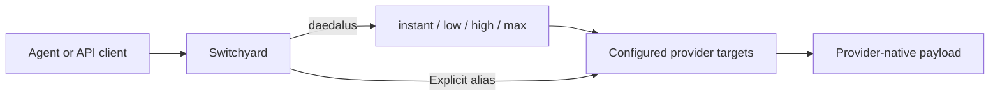

# Switchyard on Daedalus

This repository builds NVIDIA-NeMo Switchyard v0.3.0 from commit
`336196f6fbfc97ddc71c1700f6092e564e9f23c2` with local patches for target-model
aliases, Fireworks transport compatibility, credential redaction, Composite
fallback, and native decision routing. It deploys a non-root Helm workload in
the `daedalus` namespace.

The gateway exposes OpenAI Chat Completions (`/v1/chat/completions`), OpenAI
Responses (`/v1/responses`), and Anthropic Messages (`/v1/messages`), plus
`/v1/models`, `/health`, and `/metrics`. The routes below describe the repository
configuration; a running release uses the route file selected at deployment.

## Place in the Daedalus architecture

The Rust agent sends model requests to Switchyard, which owns automatic effort
classification, provider translation and model fallback. The agent calls the
sandbox execution service and the context stack directly. Context owns ingestion,
storage, embeddings, reranking and infrastructure MCP services; it is not one
gateway endpoint. Hindsight is an externally owned integration.

A representative tool request follows agent → Switchyard → provider → agent.
The agent executes the requested retrieval or sandbox tool, checks its result,
and sends the resulting continuation through Switchyard. That continuation is
classified again on the automatic route; an explicit alias stays explicit.
Switchyard does not own tool authorization, workspace state, corpus publication
or retries of executed tool effects. Retrieved text and execution output remain
untrusted model input, not routing permissions.

Correlate model calls using propagated request IDs. Agent run IDs, provider
affinity, sandbox execution IDs, ingestion jobs and MCP sessions are separate
identities. Source routes, rendered ConfigMaps and running image revisions are
separate evidence; validate all affected owners when their shared contract changes.
The parent monorepo's `daedalus-co-design` skill coordinates these checks and
retains sanitized lessons. Repository tests remain the gateway's local contract.

## Provider configurations

Selectable provider sources are every root-level `routes_*.toml` file. Discover
that inventory instead of maintaining a fixed provider list:

```bash
ls routes_*.toml
```

Select a file explicitly for validation, probes and deployment. Deployment also
accepts an operator's saved `ROUTES_FILE` in local `.env`; caller environment or
Make command-line selection takes precedence, including explicit empty values.
No provider is chosen by filename order or an implicit default. Adding a provider file adds it
to the configuration contract tests and creates its `deploy-route_<provider>`
Make target. Each file owns its clients, credentials, target models, reasoning
payloads, public aliases and fallback. Check those fields when onboarding a
provider; matching profile names do not establish equivalent behavior.

The chart's embedded `config.routesToml` is an older GLM classifier example.
Direct Helm use must supply `--set-file config.routesToml=<rendered provider file>`
and the corresponding `apiKeySecret.keys`, just as the deployment script does.

### Classification and public aliases

Automatic `daedalus` routing classifies the next response into four categories:

| Category | Work requirements |
| --- | --- |
| `instant` | Greetings, acknowledgments and literal repetition |
| `low` | Mechanical retrieval, transformations and predictable tool steps |
| `high` | Explanation, synthesis, implementation, research, debugging and deep analysis |
| `max` | Exceptional reasoning or concrete high-impact decisions |

Categories are distinct from explicit aliases and provider-native effort values.
The shipped agent exposes `max`, `high`, `low` and `instant`. A provider may retain
additional explicit aliases, such as OpenAI's `medium` and `xhigh`, without adding
classifier categories. Existing passthrough aliases bypass classification.
Public `none` is retired; a provider-native value with that spelling would be a
separate wire setting, not an alias.

Every automatic request is classified again, including tool continuations.
Uncertain, below-gate, timeout and invalid decisions use the selected file's
`default_target`; it need not share a classifier category's name. Provider failure
tries that default only when it differs from the selected target. There is no
retained effort floor or general cross-provider failover.

The four-category migration preserves target models/bodies, explicit aliases,
retained probability gates and fallbacks. Provider-specific native effort may
differ from the profile label: inspect the actual target `extra_body`. In
particular, `instant` does not promise disabled reasoning. Thresholds measure
classifier preference, not answer correctness, and category names do not prove
latency or cost ordering. Use matched quality/latency/cost evaluation before
claiming an improvement or tuning provider mappings.



### Provider transport and headers

Target `id` identifies a routing choice; `model` identifies the upstream model.
`extra_body` supplies defaults through a shallow top-level merge. Trusted caller
fields take precedence, including reasoning effort. Responses requests are
translated to Chat for Chat clients; native Responses clients use that transport.
Preserve tool-call/result IDs, reasoning history and terminal stream handling.
Leave `stream` unset on Chat targets: a target-level default overrides explicit
non-streaming requests in this build. Do not add Responses-only `truncation` to
Chat target defaults.

Configured provider affinity headers are separate from request correlation and
routing sessions. The gateway preserves standard `user` through Responses-to-Chat
translation and allowlists `x-request-id`. Inbound arbitrary provider-affinity
headers are not forwarded with server-owned credentials.

Some provider files use `${GLOBAL_SESSION_ID}` in `llm_clients.*.extra_headers`.
Set it in the environment or `.env` when required by the selected file. Rendering
substitutes only those header values, once. Caller environment overrides `.env`;
missing/empty values, malformed references and control characters fail before
cluster changes. Rendered headers become ConfigMap values, not API-key Secret
entries. Changing a configured affinity ID requires redeployment.

```bash
bash scripts/render_routes.sh routes_fireworks.toml /tmp/switchyard-routes.toml
```

The server does not expand placeholders itself. Direct server/Helm invocation
must use the rendered file. Provider credentials remain in their configured
environment variables, discovered by `scripts/list_api_key_envs.py`.

## Automatic decision service

The `[routes.stage]` table uses `decision_api`. With `model = "auto"`, the gateway
discovers the service's served model through `/v1/models` on each classification.
The service receives SystemOne state and an `effort` choice question containing
the four categories plus `uncertain`. The gateway validates identity, options,
normalized probabilities and usage; optional `x_label_mass` does not gate routing.

Judge context includes client instructions, the opening task, latest ordinary
user instruction, six recent messages and tool names; private reasoning is
omitted. Automatic input budgeting reads hosted limits and tokenizes the complete
decision prompt. Truncation trims only judge context, preserving the answer
request. Discovery, tokenization, fitting and scoring share the configured
deadline. Unsupported media or unavailable tokenization uses the fallback.
See [input limits](docs/decision-input-limits.md) and
[standalone routing](docs/standalone-decision-routing.md).

Classifier service authentication uses optional `api_key_env`; the deployment
key discovery includes it. Caller credentials and arbitrary headers are not
forwarded to the judge. Routing grants no permissions or privacy guarantees.

## Validate and test

Use Python 3.11+, Bash 4+, Helm and kubectl. Select a file explicitly:

```bash
make validate ROUTES_FILE=routes_fireworks.toml
# Include new provider files automatically:
for routes in routes_*.toml; do
  make validate ROUTES_FILE="$routes"
done
```

Validation renders headers, discovers credential names, lints the chart and
performs a client-side Kubernetes dry run. It does not verify provider capability
or routing quality. The offline suite discovers every provider source:

```bash
python3 -m unittest discover -s tests -v
SWITCHYARD_TEST_BINARY=/path/to/switchyard-server \
  python3 -m unittest discover -s tests -v
```

Without the built binary, HTTP transport tests are skipped. Older algorithm
fixtures test compatibility separately from the current deployment policy.
`tests/test_responses_transport.py` discovers native Responses aliases and checks
both streaming modes, target defaults, caller reasoning overrides and tool-result
IDs against a synthetic provider. Native Responses preserves the caller's stream
choice even when a target supplies `stream = true`; the Chat restriction above
is transport-specific. These fixtures do not verify real provider capabilities.

Live probes require the intended configuration to be deployed first:

```bash
make test routes_fireworks.toml
make test ROUTES_FILE=routes_fireworks.toml TEST_BASE_URL=http://localhost:4000/v1
python3 scripts/test_decision_judge.py routes_fireworks.toml \
  --base-url http://127.0.0.1:30090/v1 --output /tmp/decision-routing-probe.json
```

These are real model requests. Route smoke sends one non-streaming Responses
request per configured alias, asks for `OK`, and defaults to 4096 output tokens
and 120 seconds per route. A pass needs completed, nonempty text; it is not a
quality benchmark. `TEST_TIMEOUT` and `TEST_MAX_OUTPUT_TOKENS` bound each request.
Without `TEST_BASE_URL`, the harness temporarily port-forwards the selected
context's `daedalus/service/switchyard:4000`. `TEST_NAMESPACE` and `TEST_SERVICE`
override that destination. The judge probe checks question/score contracts,
not answering correctness. Neither probe deploys or verifies loaded/source parity.

## Repository layout

- `routes_*.toml`: discovered provider clients, targets and routes.
- `charts/switchyard/`: workload, Service and network policies.
- `Dockerfile` and `patches/`: pinned upstream build and transport/routing extensions.
- `scripts/deploy.sh`, `scripts/deploy_state.py`: capability gate, deployment and recovery.
- `scripts/check_capabilities.py`: generation/tool and context checks.
- `scripts/render_routes.*`: provider-header rendering.
- `tests/`: all-provider configuration and synthetic HTTP regressions.
- `docs/investigations/`: frozen historical evidence, not current deployment inputs.

## Build, publish, and deploy

Copy `.env.example` to `.env` if creating a new credential file. It contains a
`FIREWORKS_API_KEY` placeholder; add `OPENAI_API_KEY` when deploying the OpenAI
profile. Supply every `api_key_env` referenced by the selected file. `.env` is
ignored by Git. Caller environment values take precedence over `.env`; unrelated
variables are ignored. Credentials become Kubernetes Secret keys, not Helm
values or ConfigMap contents.

Providers with configured affinity placeholders require `GLOBAL_SESSION_ID` for shared affinity
headers. `.env.example` includes this non-secret setting; keep the existing ID
when migrating a deployment to preserve its affinity key.

Save the intended provider in `.env`, for example `ROUTES_FILE=routes_fireworks.toml`,
then use:

```bash
make deploy
# Override the saved selection for this deployment:
make deploy ROUTES_FILE=routes_openai.toml
```

`make deploy` validates the selected configuration, credentials and Kubernetes
context, renders/lints the chart, and passes the provider capability gate before
building or publishing. It builds the current checkout for `linux/amd64` with refreshed base images,
pushes the selected repository/tag, resolves that image's immutable repository
digest, and upgrades the existing release to that digest. Build, push or digest
resolution failures stop before Secret updates or release changes. This path
preserves existing resources and data; it does not uninstall the release or delete
PVCs. Its restart annotation and `imagePullPolicy: Always` also refresh containers
when the same source is redeployed.

Provider-specific convenience targets use the same path exactly once:

```bash
make deploy-route_fireworks
make deploy-route_openai
```

The Makefile discovers these targets from `routes_*.toml`; new provider files
create matching targets automatically.
To build or publish separately, use `make image` or `make publish`. To intentionally
deploy an already-published image without rebuilding:

```bash
make deploy-existing ROUTES_FILE=routes_fireworks.toml
make deploy-existing ROUTES_FILE=routes_openai.toml IMAGE_DIGEST=sha256:<digest>
```

Defaults and operator overrides:

| Setting | Default |
| --- | --- |
| `ROUTES_FILE` | Required explicit provider file; may be saved in local `.env` for deployment |
| `IMAGE_REPOSITORY` | `daedalus.ddns.me:5050/btuttle/switchyard` |
| `IMAGE_TAG` | `v0.3.0` |
| `IMAGE_PLATFORM` | `linux/amd64`, matching chart scheduling |
| `EXPECTED_CONTEXT` | `kubernetes-admin@kubernetes` |
| Namespace | `daedalus` (fixed by the deployment script) |
| `RELEASE_NAME` | `switchyard` |
| `SECRET_NAME` | `switchyard-api-key` |
| `HELM_TIMEOUT` | `10m` |
| `CAPABILITY_TIMEOUT` | `60` seconds |
| `CAPABILITY_MAX_OUTPUT_TOKENS` | `4096` |

The rebuild path discovers the pushed digest and rejects a preset `IMAGE_DIGEST`
so an old image cannot override the new build. Use `deploy-existing` for an explicit
digest or existing tag; that mode retains the same validation, backup and rollout
checks. Caller environment and Make command-line deployment settings override
`.env`. Change release/Secret names only when intending to change those resource names.

The script snapshots the selected TOML and renders header variables once, so
validation, probing and deployment use the same resolved contents even if the
source file or `.env` changes during probing. Before changing resources, the capability gate checks every
distinct provider/model/settings combination. Generation or tool failures block
deployment. Missing or insufficient advertised context limits emit warnings;
context lookup failures also warn. See the [capability gate](docs/capability-gate.md).

After the gate passes, deployment backs up live release resources and the API-key
Secret under `.deploy-backups/` (private and ignored by Git; override with
`DEPLOY_BACKUP_DIR`). It leaves an existing shared namespace untouched. Missing
Helm ownership metadata is repaired only for the two Switchyard network policies
after checking labels, ownership and complete rules against the rendered chart.
Conflicting owners or rules stop deployment before Secret/release changes.

Each deployment adds a restart annotation so Secret and mutable-image updates
reach new containers. The script checks rollout, ready EndpointSlices and HTTP
health. The intentional NodePort-only LoadBalancer class never receives a VIP,
so it uses these checks instead of Helm's load-balancer wait. Other Service
configurations retain Helm's wait.

If upgrade/readiness fails and a prior deployment can be restored, recovery
reinstates the saved live resources through a recovery Helm chart and restores
the prior Secret. The backup contains `restore.sh` for manual recovery:
`bash .deploy-backups/<deployment>/restore.sh`. Recovery creates a Helm revision.
Keep backups private because they contain credentials. Avoid rollback to an old
revision with a ClusterIP-only Service; the live snapshot preserves LAN access.

### Workload defaults

The chart runs one replica as UID/GID 1000, with a read-only root filesystem,
no privilege escalation, all capabilities dropped, `RuntimeDefault` seccomp,
and no mounted service-account token. CPU/memory requests are `50m`/`64Mi`;
limits are `1` CPU/`512Mi`. It requires `amd64` and excludes the ARM64
`daedalus-06` worker. Publish a compatible image and override `nodeSelector`
and `affinity` together if that topology changes; change `IMAGE_PLATFORM` with
those scheduling settings when building for another architecture.

The selected TOML is mounted as `routes.toml` from a ConfigMap. Startup,
readiness and liveness probes use `/health`. Logs default to `info`, shutdown
timeout to `30s`, and termination grace to 40 seconds. The PodDisruptionBudget
and Prometheus ServiceMonitor are disabled by default; the latter can scrape
`/metrics` when enabled.

## Call the route and preserve LAN access

The Service preserves HTTP NodePort **30260** for home-LAN clients throughout
`192.168.1.0/24`, including ordinary clients outside the cluster. For example,
use `http://192.168.1.234:30260/v1`; the same port works on each cluster node.
Daedalus agent and Hindsight API pods in the same namespace are also permitted
by the chart's ingress policy and use:

```text
http://switchyard.daedalus.svc.cluster.local:4000/v1
```

The Service uses `LoadBalancer` with the unhandled
`daedalus.ai/nodeport-only` class to retain the fixed NodePort without allocating
a separate VIP. Cilium's `bpf.lbSourceRangeAllTypes=true` applies
`service.loadBalancerSourceRanges` before cross-node SNAT. The accompanying
policy permits forwarding on port 4000, including Cilium's `world` identity:
external connections retain that identity after cross-node SNAT. The Service
still restricts the original source to `192.168.1.0/24`; unrelated pods receive
no new grant. Deployment verifies the source-range filter is enabled.
If CiliumInternalIPs change, refresh `networkPolicy.nodeSourceCIDRs`.

After network changes, verify `/health`, `/v1/models` and a generation request
from a non-node LAN device, such as `daedalus-07` (`192.168.1.240`). Include
`192.168.1.234:30260` with the pod on another node to exercise external
forwarding. Deployment's cluster health checks alone do not verify this path.

The caller interface retains its HTTP contract without a new bearer-key
requirement. Provider credentials authenticate upstream requests. Local operator
checks can use `make test` or authenticated Kubernetes port forwarding.

```bash
curl http://switchyard.daedalus.svc.cluster.local:4000/v1/responses \
  -H 'Content-Type: application/json' \
  -d '{"model":"daedalus","input":"Inspect and fix the failing tests."}'
```

Use an explicit model such as `daedalus/high` to bypass classification.
Routed responses include `x-model-router-selected-model` and, when available,
`x-model-router-rationale`. The selected-model header identifies the target,
such as `high` or `xhigh`; the upstream request uses its configured `model`.
