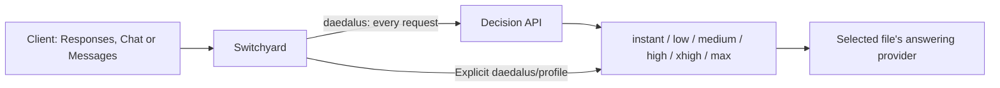

# Switchyard on Daedalus

This repository builds NVIDIA-NeMo Switchyard v0.3.0 from commit
`336196f6fbfc97ddc71c1700f6092e564e9f23c2` with local patches for target-model
aliases, Fireworks transport compatibility, credential redaction, Composite
fallback, and native decision routing. It deploys a non-root Helm workload in
the `daedalus` namespace.

The gateway exposes OpenAI Chat Completions (`/v1/chat/completions`), OpenAI
Responses (`/v1/responses`), and Anthropic Messages (`/v1/messages`), plus
`/v1/models`, `/health`, and `/metrics`. The routes below describe the repository
configuration; a running release uses the route file selected at deployment.

## Available configurations

Only two `routes_*.toml` deployment sources are currently present:

| Configuration | Answering model | Upstream transport | Required credential | Automatic fallback |
| --- | --- | --- | --- | --- |
| [routes_custom.toml](routes_custom.toml) (default) | DeepSeek V4.1 Flash 1017 Ultrafast + Kimi K3.1 Pro | `openai_chat` at `https://api.fireworks.ai/inference/v1` | `FIREWORKS_API_KEY` | `xhigh` |
| [routes_openai.toml](routes_openai.toml) | `gpt-6-luna` | `openai_responses` at `https://api.openai.com/v1` | `OPENAI_API_KEY` | `medium` |

Both files use the decision service at
`http://decision-api.daedalus.svc.cluster.local:30000/v1` for automatic selection.
Neither file defines a local answering target or requires `LOCAL_API_KEY`.
The earlier CoreWeave, Inception, and local-only route files are no longer
available. `routes_custom.toml.bk` is a backup, not a selectable Make variant.

The Helm chart's embedded `config.routesToml` remains an older GLM 5.2
`llm_classifier` example. The Makefile and deployment script override it with
the selected file. Direct Helm use must also supply
`--set-file config.routesToml=<rendered routes file>` (see
[header environment variables](#header-environment-variables)) and the corresponding
`apiKeySecret.keys` to reproduce either configuration above.

### Public model routes

Both configurations expose exactly these seven model IDs:

| Requested model | Custom: model / effort | OpenAI: effort |
| --- | --- | --- |
| `daedalus` | Fresh decision among all six targets | Selected target's effort |
| `daedalus/max` | Kimi K3.1 Pro / `max` | `max` |
| `daedalus/xhigh` | Kimi K3.1 Pro / `high` | `xhigh` |
| `daedalus/high` | Kimi K3.1 Pro / `low` | `high` |
| `daedalus/medium` | DeepSeek V4.1 Flash 1017 Ultrafast / `high` | `medium` |
| `daedalus/low` | DeepSeek V4.1 Flash 1017 Ultrafast / `low` | `low` |
| `daedalus/instant` | DeepSeek V4.1 Flash 1017 Ultrafast / `none` | `low` |

Custom names are work profiles, not a claim that provider effort strings are
comparable across models. The two model families each provide three distinct
configurations. `instant` disables reasoning by default; the model still supports
reasoning when a caller overrides that default. All custom answering targets use
Fireworks serverless. See the [optimization evidence](docs/investigations/routes-optimization-2026-11-06/README.md).

The six explicit routes are `passthrough` routes and bypass the classifier.
All seven enable tool calling and reasoning. Each explicit route also declares
`vision = true` and `context_window = 1048576`; the automatic route does not
set those two fields. These are configuration declarations, not measured
provider capabilities. The deployment gate checks generation/tool support and
reports advertised context limits.

`daedalus/deep`, `daedalus/none`, `daedalus/local`, and
`daedalus/hindsight-local` are no longer defined in either file. None of the
current routes provides local-only answering.



### Provider defaults and affinity

The custom configuration uses DeepSeek Ultrafast for responsive routine work and
Kimi K3.1 Pro for demanding work. All six targets use `reasoning_history =
"interleaved"`, retaining reasoning within the current tool turn while clearing
it across user turns. Each sets `context_length_exceeded_behavior = "truncate"`
and leave `stream` unset so the caller controls streaming. A target-level
`stream = true` in this build incorrectly overrides explicit non-streaming
requests. For example:

```toml
[targets.xhigh]
id = "xhigh"
model = "accounts/fireworks/models/kimi-k3p1-pro"
llm_client = "fireworks"
extra_body = { reasoning_effort = "high", context_length_exceeded_behavior = "truncate", reasoning_history = "interleaved" }
```

The OpenAI targets all use `gpt-6-luna`, with `text.verbosity = "low"`,
`reasoning.summary = "concise"`, `store = false`, and `stream = true`.
Effort is supplied through `reasoning.effort`; `instant` and `low` currently
have identical target defaults.

Target `id` identifies the routing choice; `model` identifies the upstream
model. `extra_body` supplies defaults through a shallow top-level merge.
Caller-supplied fields take precedence, including explicit reasoning effort;
a route name does not force that effort when the caller overrides it.
Responses requests are translated to Chat Completions for Fireworks, including
tool calls/results and reasoning history. OpenAI uses native Responses transport.
Do not add the Responses-only `truncation` field to Fireworks target defaults.

The custom client sets `x-multi-turn-session-id` and `x-session-affinity` from
`${GLOBAL_SESSION_ID}`, resolved during validation/deployment from the caller's
environment or `.env`. Both headers share the same value for all requests. This groups
traffic under a shared provider affinity key. The OpenAI client has no configured
extra headers. These are server-configured headers; inbound provider-affinity
headers are not forwarded with server-owned credentials. The patched gateway
preserves the standard `user` field through Responses-to-Chat translation and
allowlists the caller's `x-request-id`. `x-switchyard-session-id` is separate
routing state and is not required by the current standalone classifier.

### Header environment variables

`routes_custom.toml` uses:

```toml
extra_headers = { x-multi-turn-session-id = "${GLOBAL_SESSION_ID}", x-session-affinity = "${GLOBAL_SESSION_ID}" }
```

Set the non-secret shared ID in `.env` or the calling environment:

```bash
GLOBAL_SESSION_ID=your-shared-session-id
```

`make validate`, `make helm-lint`, `make helm-template`, and `make deploy` render
`${NAME}` references only inside `llm_clients.*.extra_headers` values. Exported
caller values take precedence over `.env`, including an explicitly empty value
(which fails validation). Missing or empty variables, malformed references, and
control characters in substituted values fail before Helm or cluster changes.
Prompts, model names, credential references and other fields are not interpolated.
Substitution is a single pass; variable contents are never evaluated as shell code.
Existing literal headers continue to work.

The source TOML remains a template. The rendered copy contains literal headers
in the ConfigMap; these variables are not added to the API-key Secret or container
environment. Changing the ID requires redeployment. The server itself does not
expand placeholders, so direct Helm/server use must first render a copy:

```bash
bash scripts/render_routes.sh routes_custom.toml /tmp/switchyard-routes.toml
```

Use that output for `--set-file config.routesToml=...` or the server's `--config`.
The wrapper loads the repository's `.env` with the same Bash syntax used by the
deployment script. Its Python helper can also run directly with already-exported
variables: `python3 scripts/render_routes.py SOURCE OUTPUT`.

## Automatic reasoning routing

Both files retain the table name `[routes.stage]`, but its type is
`decision_api`, not the historical stage or Composite algorithm. Every request
to `daedalus` is classified anew, including tool continuations and retries.
There is no retained task floor, stage override, or recovery hold.

The classifier chooses among six named choices plus `uncertain`:

| Choice | Custom minimum winning probability | OpenAI minimum | Custom intended work |
| --- | ---: | ---: | --- |
| `instant` | 0.90 | 0.90 | Trivial greetings, acknowledgments, verbatim repetition |
| `low` | 0.60 | 0.80 | Mechanical extraction, direct facts, predictable tool loops |
| `medium` | 0.50 | 0.70 | Ordinary implementation, research, synthesis and verification |
| `high` | 0.50 | 0.60 | Hard debugging, multi-step inference and adaptive investigation |
| `xhigh` | 0.55 | 0.55 | Deep analysis, conflicting evidence and independent cross-checks |
| `max` | 0.50 | 0.50 | Exceptional difficulty or concrete high-impact work |

These gates are policy settings, not calibrated probabilities of task success.
Uncertain or below-gate choices, classifier failures, and timeouts use the
actual `default_target`: **`xhigh` for custom; `medium` for OpenAI**. An
answering-provider failure tries only that default when it differs from the
selected target; it does not cycle through all choices or switch providers.
The next automatic request is classified again.

Shared classifier settings are:

```toml
[routes.stage.classifier]
type = "decision_api"
base_url = "http://decision-api.daedalus.svc.cluster.local:30000/v1"
model = "auto"
classify_trigger = "every_request"
timeout_ms = 2000
recent_turn_window = 6
max_input_tokens = "auto"
truncate_input = true
max_request_bytes = 65536
# Keep instructions, uncertain_criteria and all choices from the selected file.
```

With `model = "auto"`, the gateway discovers the decision service's single
served model through `/v1/models` on each classification. An explicit model ID
pins selection instead. The service receives SystemOne `state` and a typed
choice question named `effort`. The gateway validates question/options,
normalized probabilities, winning choice, response identity and native usage.
Optional SGLang `x_label_mass` metadata is accepted but does not gate routing.

Judge context includes client instructions, the opening task, latest ordinary
user instruction, six recent messages and available tool names; private
reasoning is omitted. Automatic input budgeting reads the hosted context limit
and counts the complete decision prompt through `/v1/tokenize`. It trims only
classifier context, leaving answer requests intact. With truncation enabled,
the old `max_request_bytes` rejection gate is bypassed. Discovery, tokenization,
fitting and scoring share the two-second deadline. Missing metadata,
unsupported media or tokenization failure use the configured fallback.
See [decision input limits](docs/decision-input-limits.md) and
[standalone routing and QA](docs/standalone-decision-routing.md) for implementation
details; historical model mappings in those records are not the current route inventory.

Neither classifier currently sets `api_key_env`. To enable service-owned bearer
authentication, add `api_key_env = "DECISION_API_KEY"` and supply the credential;
`scripts/list_api_key_envs.py` discovers classifier keys as well as provider keys.
Caller credentials and arbitrary headers are not forwarded to the judge.

### Known configuration discrepancies

The custom prompt now matches the executable fallback and describes task
requirements without embedding provider model names that can drift. Its judge
is discovered from the internal decision service; answering stays on Fireworks.

The separate OpenAI configuration was not changed by the custom optimization.
Its prompt still describes Fireworks answering models, high effort for instant,
an instant fallback and a Rune judge, while its executable settings use
`gpt-6-luna`, low effort for instant, medium fallback and judge discovery. Its
max comment also incorrectly describes the 0.50 gate as absent. Treat the target
fields and numeric gates as authoritative. Neither configuration supplies a
local-processing answering boundary.

## Repository layout and patches

- `routes_custom.toml` and `routes_openai.toml`: selectable clients, targets and routes.
- `charts/switchyard/`: Helm chart, workload, Service and network policies.
- `Dockerfile` and `patches/`: pinned upstream build and local extensions.
- `scripts/deploy.sh` and `scripts/deploy_state.py`: capability checks, deployment,
  backups and recovery.
- `scripts/check_capabilities.py`: provider generation/tool and context checks.
- `scripts/render_routes.sh` and `scripts/render_routes.py`: header environment loading and TOML rendering.
- `scripts/test_routes.py`: live route smoke checks.
- `scripts/test_decision_judge.py`: synthetic judge contract/policy probes.
- `tests/`: configuration, deployment and HTTP fixture regressions.
- `docs/`: implementation notes and historical investigation records.

The Dockerfile applies patches in order and runs focused Rust regressions before
building the final server. Target-model aliases allow independent defaults for
routes sharing a provider model. Fireworks patches translate assistant-history
reasoning to `reasoning_content` and normalize tool-parameter presence constraints
without discarding their original JSON Schema constraints. Structural credential
redaction walks decoded JSON, including JSON inside tool arguments, so credential
replacement cannot corrupt serialized stream events. Native decision patches
add named choices, SGLang metadata support, model discovery, standalone routing
and hosted input budgeting. Legacy Composite support remains in the binary.
These configurations require the patched image built by this repository.

## Validate and test

Requires Python 3.11+, Helm and kubectl for chart validation:

```bash
make validate
make validate ROUTES_FILE=routes_openai.toml
```

This resolves header variables, discovers credential names, lints the chart, renders the selected routes
into the `daedalus` namespace, and runs Kubernetes client-side dry-run validation.
It does not validate routing policy or prove provider compatibility.

The route smoke harness can be tested without provider credentials:

```bash
python3 -m unittest discover -s tests -p 'test_route_smoke.py' -v
```

The broader suite includes HTTP fixtures that require the actual patched binary:

```bash
SWITCHYARD_TEST_BINARY=/path/to/switchyard-server \
  python3 -m unittest discover -s tests -v
```

Some configuration/transport tests still assume removed local aliases or earlier
provider mappings, notably `tests/test_bolt_local_routes.py`. The custom configuration assertions
in `tests/test_fireworks_routes.py` were updated with this optimization. Those expectations need reconciliation with
the current route files; the full suite should not be assumed to pass unchanged.

To test a deployed configuration:

```bash
make test routes_custom.toml
make test
make test ROUTES_FILE=routes_openai.toml
make test routes_custom.toml TEST_BASE_URL=http://localhost:4000/v1
make test routes_custom.toml TEST_TIMEOUT=180 TEST_MAX_OUTPUT_TOKENS=8192
```

The command sends one live, non-streaming `/v1/responses` request for every
`[routes]` entry: `daedalus` and its six explicit profiles. It asks for `OK`,
with a default 4096-token output budget and 120-second timeout per route.
No reasoning effort is supplied. A pass requires a completed response with
nonempty assistant text; any failed route produces a nonzero exit status.
These are real provider requests, not an answer-quality benchmark.

The local TOML supplies model IDs to test; the running server supplies policy
and credentials. Deploy the intended file first: the tester does not deploy or
compare the mounted configuration. By default it temporarily port-forwards
`daedalus/service/switchyard:4000` using `EXPECTED_CONTEXT`. `TEST_NAMESPACE`
and `TEST_SERVICE` override the destination. Supplying `TEST_BASE_URL` bypasses
kubectl and accepts a URL with or without `/v1`.

To probe the configured judge with 20 synthetic workloads:

```bash
kubectl -n daedalus port-forward service/decision-api 30090:30000
# In another terminal:
python3 scripts/test_decision_judge.py routes_custom.toml \
  --base-url http://127.0.0.1:30090/v1 --output /tmp/decision-routing-probe.json
```

This reports contract checks, winning labels and targets after probability gates.
It does not execute the synthetic tasks or establish answering quality, latency
savings or routing accuracy. `make test` does not run this probe.

## Build, publish, and deploy

Copy `.env.example` to `.env` if creating a new credential file. It contains a
`FIREWORKS_API_KEY` placeholder; add `OPENAI_API_KEY` when deploying the OpenAI
profile. Supply every `api_key_env` referenced by the selected file. `.env` is
ignored by Git. Caller environment values take precedence over `.env`; unrelated
variables are ignored. Credentials become Kubernetes Secret keys, not Helm
values or ConfigMap contents.

The custom profile also requires `GLOBAL_SESSION_ID` for its shared affinity
headers. `.env.example` includes this non-secret setting; keep the existing ID
when migrating a deployment to preserve its affinity key.

The currently available build/push/deploy targets are:

```bash
make deploy-route_custom
make deploy-route_openai
```

The Makefile discovers these targets from `routes_*.toml`; there is no current
`deploy-route_fireworks`, `deploy-route_local`, or `deploy-route_inception` target.
To build or publish separately, use `make image` or `make publish`. To deploy an
already-published image:

```bash
make deploy ROUTES_FILE=routes_custom.toml
make deploy ROUTES_FILE=routes_openai.toml
```

Defaults and operator overrides:

| Setting | Default |
| --- | --- |
| `ROUTES_FILE` | `routes_custom.toml` |
| `IMAGE_REPOSITORY` | `daedalus.ddns.me:5050/btuttle/switchyard` |
| `IMAGE_TAG` | `v0.3.0` |
| `EXPECTED_CONTEXT` | `kubernetes-admin@kubernetes` |
| Namespace | `daedalus` (fixed by the deployment script) |
| `RELEASE_NAME` | `switchyard` |
| `SECRET_NAME` | `switchyard-api-key` |
| `HELM_TIMEOUT` | `10m` |
| `CAPABILITY_TIMEOUT` | `60` seconds |
| `CAPABILITY_MAX_OUTPUT_TOKENS` | `4096` |

For an immutable image, pass `IMAGE_DIGEST=sha256:...` with the pushed manifest
digest during deployment. Change release/Secret names only when intending to
change those resource names.

The script snapshots the selected TOML and renders header variables once, so
validation, probing and deployment use the same resolved contents even if the
source file or `.env` changes during probing. Before changing resources, the capability gate checks every
distinct provider/model/settings combination. Generation or tool failures block
deployment. Missing or insufficient advertised context limits emit warnings;
context lookup failures also warn. See the [capability gate](docs/capability-gate.md).

After the gate passes, deployment backs up live release resources and the API-key
Secret under `.deploy-backups/` (private and ignored by Git; override with
`DEPLOY_BACKUP_DIR`). It leaves an existing shared namespace untouched. Missing
Helm ownership metadata is repaired only for the two Switchyard network policies
after checking labels, ownership and complete rules against the rendered chart.
Conflicting owners or rules stop deployment before Secret/release changes.

Each deployment adds a restart annotation so Secret and mutable-image updates
reach new containers. The script checks rollout, ready EndpointSlices and HTTP
health. The intentional NodePort-only LoadBalancer class never receives a VIP,
so it uses these checks instead of Helm's load-balancer wait. Other Service
configurations retain Helm's wait.

If upgrade/readiness fails and a prior deployment can be restored, recovery
reinstates the saved live resources through a recovery Helm chart and restores
the prior Secret. The backup contains `restore.sh` for manual recovery:
`bash .deploy-backups/<deployment>/restore.sh`. Recovery creates a Helm revision.
Keep backups private because they contain credentials. Avoid rollback to an old
revision with a ClusterIP-only Service; the live snapshot preserves LAN access.

### Workload defaults

The chart runs one replica as UID/GID 1000, with a read-only root filesystem,
no privilege escalation, all capabilities dropped, `RuntimeDefault` seccomp,
and no mounted service-account token. CPU/memory requests are `50m`/`64Mi`;
limits are `1` CPU/`512Mi`. It requires `amd64` and excludes the ARM64
`daedalus-06` worker. Publish a compatible image and override `nodeSelector`
and `affinity` together if that topology changes.

The selected TOML is mounted as `routes.toml` from a ConfigMap. Startup,
readiness and liveness probes use `/health`. Logs default to `info`, shutdown
timeout to `30s`, and termination grace to 40 seconds. The PodDisruptionBudget
and Prometheus ServiceMonitor are disabled by default; the latter can scrape
`/metrics` when enabled.

## Call the route and preserve LAN access

The Service preserves HTTP NodePort **30260** for home-LAN clients throughout
`192.168.1.0/24`, including ordinary clients outside the cluster. For example,
use `http://192.168.1.234:30260/v1`; the same port works on each cluster node.
Daedalus agent and Hindsight API pods in the same namespace are also permitted
by the chart's ingress policy and use:

```text
http://switchyard.daedalus.svc.cluster.local:4000/v1
```

The Service uses `LoadBalancer` with the unhandled
`daedalus.ai/nodeport-only` class to retain the fixed NodePort without allocating
a separate VIP. Cilium's `bpf.lbSourceRangeAllTypes=true` applies
`service.loadBalancerSourceRanges` before cross-node SNAT. The accompanying
policy permits forwarding on port 4000, including Cilium's `world` identity:
external connections retain that identity after cross-node SNAT. The Service
still restricts the original source to `192.168.1.0/24`; unrelated pods receive
no new grant. Deployment verifies the source-range filter is enabled.
If CiliumInternalIPs change, refresh `networkPolicy.nodeSourceCIDRs`.

After network changes, verify `/health`, `/v1/models` and a generation request
from a non-node LAN device, such as `daedalus-07` (`192.168.1.240`). Include
`192.168.1.234:30260` with the pod on another node to exercise external
forwarding. Deployment's cluster health checks alone do not verify this path.

The caller interface retains its HTTP contract without a new bearer-key
requirement. Provider credentials authenticate upstream requests. Local operator
checks can use `make test` or authenticated Kubernetes port forwarding.

```bash
curl http://switchyard.daedalus.svc.cluster.local:4000/v1/responses \
  -H 'Content-Type: application/json' \
  -d '{"model":"daedalus","input":"Inspect and fix the failing tests."}'
```

Use an explicit model such as `daedalus/medium` to bypass classification.
Routed responses include `x-model-router-selected-model` and, when available,
`x-model-router-rationale`. The selected-model header identifies the target,
such as `high` or `xhigh`; the upstream request uses its configured `model`.
